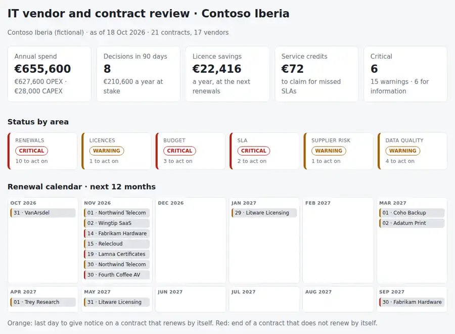

# IT Vendor Contract Tracker

A monthly review of the **IT contracts, renewals, licences, budget and supplier SLAs** from the register you already keep in a spreadsheet: which notice deadlines are coming, which contracts renew by themselves next month, where you pay for licences nobody uses (or use more than you bought), which budget lines will end the year over, which vendors missed their SLA and owe a service credit, and which critical services depend on one supplier with no exit plan. A few CSV files, one Python command, and the answer to: **what do we have to decide, cancel, claim or renegotiate this month, and by when?**

Python 3.10+, standard library only. Runs with fictional demo data out of the box.



## Why

Contracts rarely go wrong in a dramatic way. They go wrong quietly:

- a contract with **60 days' notice renews by itself** for another year because nobody looked at the date in time,
- the **support on a firewall ends** and nobody notices until the day you need a replacement,
- you pay for **60 licences of an add-on and 34 are assigned**, while the main suite is **12 seats over** what you bought and the true-up arrives with the next invoice,
- a budget line is **on pace to end 14% over** in October, when there is still time to act,
- a vendor **misses its SLA two months running** and the service credit in the contract is never claimed,
- the WAN, the most critical service, has **one supplier and no written exit plan**.

This tool puts all of that in one page and one work list, in date order, with the next step for each.

## What it checks

| Area | Checks |
|---|---|
| Renewals | Contracts that renew by themselves: days left to give notice (critical at 14 days, warning at 45, information at 90). Contracts that do not renew: days to the end date (critical at 30, warning at 90, information at 180). Contracts that already ended, or renewed by themselves while the register still shows the old date (the new term is calculated). |
| Licences | Over-deployed (in use above purchased, with the true-up cost); under 80% in use with at least 5 spare (savings a year at the next renewal). Unit cost from the contract or from annual cost / quantity. |
| Budget | Straight-line forecast from the spend to date and the share of the fiscal year gone: over budget by more than 3% (warning) or 10% (critical), under by more than 15% (headroom). Contracts charged to a line that add up to more than its budget. |
| SLA | Months below target in the last three: one (warning) or two or more (critical), with the service credit to claim when the contract has one. Missing monthly reports. |
| Supplier risk | Critical services with a single supplier and no alternative or exit plan. One vendor above 30% of the annual spend (information, for the vendor strategy). |
| Data quality | No owner, no end date, renews by itself without a notice period, no annual cost. |

Outputs: `report.html` (single file, light and dark mode, with a 12-month renewal calendar, budget bars, licence use and an SLA grid), `review.md` (Act now / This month / renewal calendar / budget / savings, ready for the monthly meeting), `actions.csv` (one row per action, worst and soonest first, with an owner, a due date, the money at stake and a `done` column), `findings.csv` and `renewals.ics` (every notice deadline and contract end in the next 12 months, with a reminder 14 days before, to import into the team calendar).

How to run the monthly review and decide a renewal: [docs/monthly-review-runbook.md](docs/monthly-review-runbook.md). File format: [docs/data-format.md](docs/data-format.md).

## Try it

```bash
git clone https://github.com/inigogonzalezgarcia/23-it-vendor-contract-tracker.git
cd 23-it-vendor-contract-tracker
python -m vendortrack demo
```

Open `output/report.html`, `output/review.md` and `output/actions.csv`, and import `output/renewals.ics` into a calendar.

The demo is a made-up company (Contoso Iberia, `contoso.example`) with 21 contracts from 17 vendors, six budget lines and six months of SLA reports, reviewed on 18 October 2026. Vendor names are Microsoft's fictional sample companies; people, prices and dates are invented. Faults are placed on purpose: firewall support that ended 18 days ago, two contracts that renew by themselves unless notice is given within 14 days, endpoint protection that renewed last year without the register being updated, a warranty extension ending in 27 days, 12 productivity licences over the purchased quantity and 26 add-on licences unused, a software budget on pace for +14%, contracts above the infrastructure budget, a print service below its SLA two months out of three, a missing SLA report, a WAN with no exit plan, two contracts without an owner, one without an end date and one without a notice period.

## Use it with your own register

1. Export your contract register to `data/contracts.csv` with the columns in [docs/data-format.md](docs/data-format.md). Only `vendor` is required; every other column turns on its check.
2. Optionally add `data/budget.csv` (budget and spend to date per line), `data/sla.csv` (one line per contract and month from the vendors' service reports) and `data/settings.json` (organisation, currency, fiscal year start).
3. Build the outputs:
   ```bash
   python -m vendortrack report data/ --out output --title "IT vendor review · October"
   ```
   Options: `--as-of 2026-10-31` (re-run a past or future review), `--notice-critical 14`, `--notice-warning 45`, `--end-critical 30`, `--end-warning 90`, `--low-utilisation 0.80`, `--concentration 0.30`.

The register and the reports contain prices and supplier terms. Keep them inside your organisation: real files at the top level (`contracts*.csv`, `budget*.csv`, `sla*.csv`, `data/`) and the `output/` folder are excluded from Git by `.gitignore`; only the fictional files in `sample_data/` are committed.

## Tests

```bash
python -m unittest discover tests      # or: pip install -r requirements-dev.txt && python -m pytest
```

17 tests: month arithmetic at month ends and leap years; decimal commas; a clean contract with no findings; notice thresholds (14, 15, 45, 46, 90 and 91 days); a notice deadline already passed; end-date thresholds for contracts that do not renew; ended contracts and contracts that renewed by themselves, including a 24-month term rolled twice; the renewal calendar on rolled terms; over-deployed and unused licences, the buffer that is not flagged and the unit cost derived from the annual cost; the straight-line budget forecast at each threshold, committed contracts above budget and the fiscal year rolling over; SLA misses with service credits and missing reports; single-supplier and concentration risk; data quality; a semicolon CSV with a BOM and Spanish values; and the demo end to end (every check fires, all outputs written, the calendar file folded to 75 bytes per line as the iCalendar standard requires).

**Next steps for your register:**

- export your register and map its columns to the ones in the data format,
- add the spend to date from finance and last month's SLA figures before each review,
- import `renewals.ics` into the team calendar so the notice deadlines come with a reminder.

## Background

Built from my work managing IT suppliers and budgets: connectivity, hardware and service vendors in a regulated financial services environment, the IT budget in a manufacturing group, licence and hardware renewals with large software and hardware vendors, contract negotiation and SLA and OLA follow-up in service reviews. Written from scratch with fictional data; no employer documents, prices or contracts are used.

## Customisation and contact

Want this adapted to your organisation (your own register columns, a link to your ITSM or finance tool, Teams or email reminders, multi-currency or a CAPEX plan)? Get in touch:

- Website (contact form): [inigogonzalezgarcia.github.io](https://inigogonzalezgarcia.github.io/about.html#contacto)
- LinkedIn: [linkedin.com/in/igonzalez93](https://www.linkedin.com/in/igonzalez93)

## License

MIT
